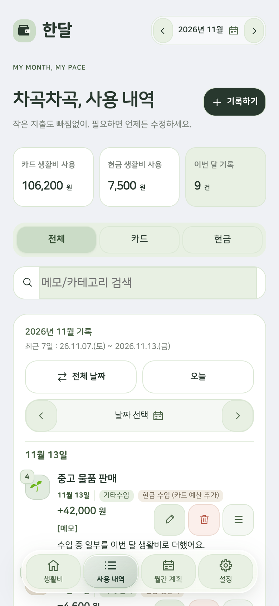
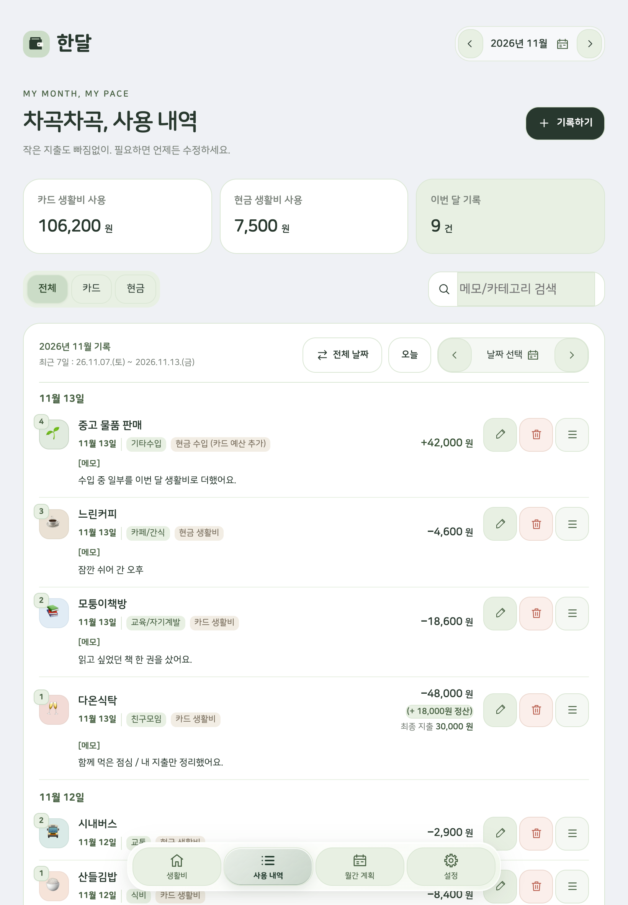
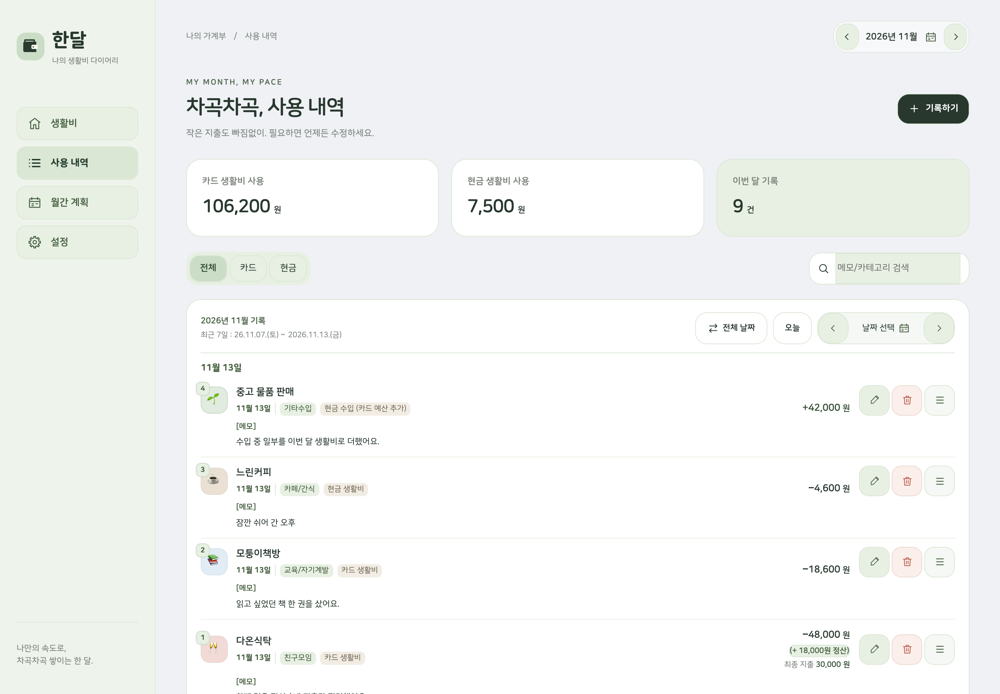
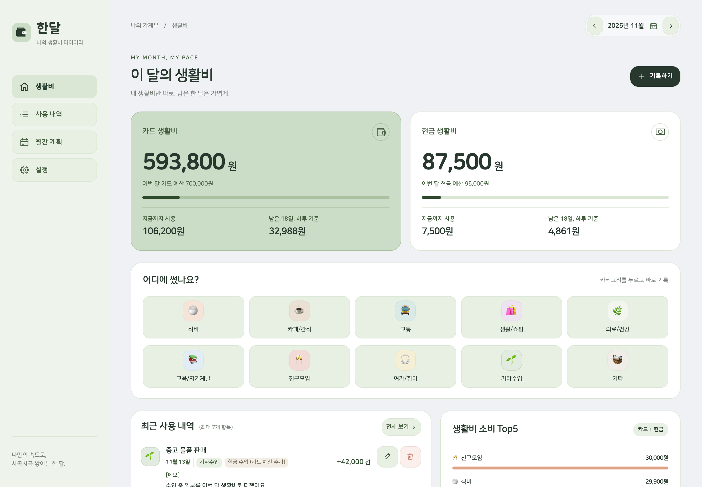
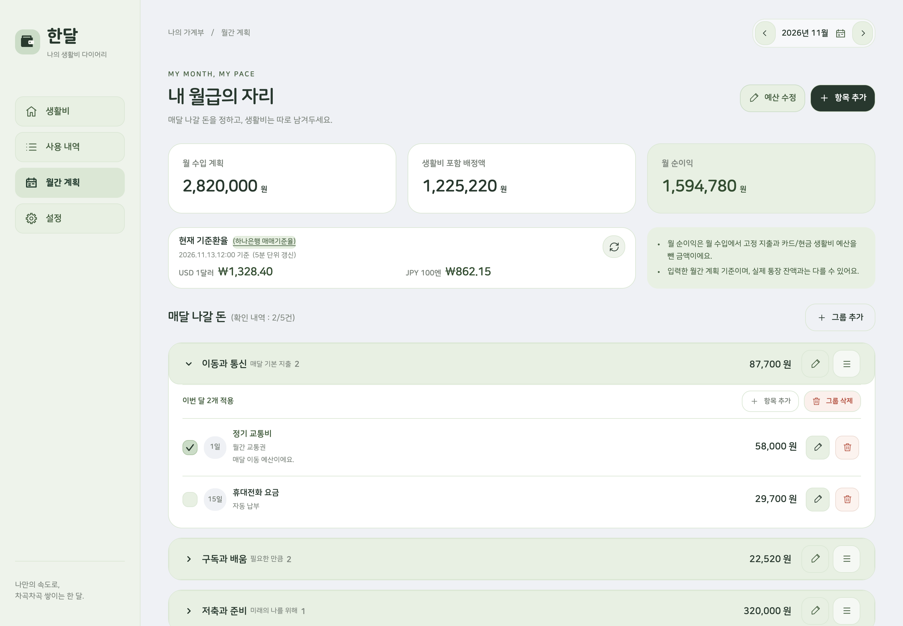

# 한달

내 생활비만 따로 정하고, 남은 금액을 차곡차곡 확인하는 개인 가계부 프로젝트입니다. 카드와 현금 예산 / 사용 내역 / 월간 계획을 한곳에서 정리해요.

[소개 페이지](https://hyeondk.github.io/handal/) / [화면과 기능 소개](TUTORIAL.md)

이 저장소와 소개 페이지는 한달의 기능과 화면을 소개하는 용도입니다. 앱 접속 링크, 설치 안내, 다운로드 파일, 개인용 배포 기능은 제공하지 않습니다.

## 어떤 기능이 있나요?

- 카드 생활비와 현금 생활비를 나누어 남은 예산과 사용량을 확인해요.
- 지출 / 환불 / 정산 / 기타수입을 정리하고, 사용 내역 제목과 메모를 따로 관리해요.
- 월간 계획에서 정기 지출과 납부 여부를 확인해요.
- 다음 달 생활비 예산을 계획하고, 카테고리와 표시 순서를 내 방식대로 구성해요.

현재 iOS 웹앱을 바탕으로 스마트폰 / 태블릿 / PC 화면을 구성했으며, Android 지원은 개발 중입니다.

## 화면으로 둘러보기

**아래 이미지는 실제 한달 화면을 가상 자료로 채워 촬영한 예시입니다.** 가게명 / 금액 / 예산 / 수입 / 정산 / 메모 / 날짜 / 환율은 모두 설명을 위해 구성했어요. 실제 사용자의 기록이나 인증 정보는 포함하지 않았습니다.

세 기기에서 같은 가상 계정의 같은 사용 내역을 보여줘요. 화면 너비에 맞춰 배치만 달라집니다.

### 스마트폰 / 사용 내역

### 태블릿 / 사용 내역

### PC / 사용 내역

### 생활비와 월간 계획

## 이 저장소의 범위

이 저장소에는 정적 소개 페이지 / 기능 설명 / 가상 예시 이미지만 포함합니다. 실행용 가계부 소스 / 사용자 기록 / 인증 정보 / 데이터베이스 연결 정보 / 서버 환경 설정은 포함하지 않습니다.

소개 페이지는 GitHub Pages의 `/handal/` 경로에서 별도 빌드 없이 게시합니다. 예시 이미지는 운영 서버에 접근하지 않고 실제 앱 소스와 합성 계정, 메모리 데이터베이스만 사용해 만들었습니다. 화면 제작 범위는 [예시 화면 설명](TUTORIAL.md#예시-화면에-대하여)에서 확인할 수 있어요.

## 사용 자산

- `assets/icon.svg`: 한달의 세이지 배경 앱 아이콘입니다.
- `assets/screenshots/`: 가상 자료로 구성한 실제 앱 예시 화면입니다.
- `assets/fonts/`: 수정하지 않은 나눔스퀘어라운드 글꼴입니다. 저작권과 재배포 조건은 함께 보존한 `font-license.txt`의 SIL 오픈 폰트 라이선스 1.1을 따릅니다.

기획 / 제작 김동현(hyeondk) / mazy454@hanmail.net
