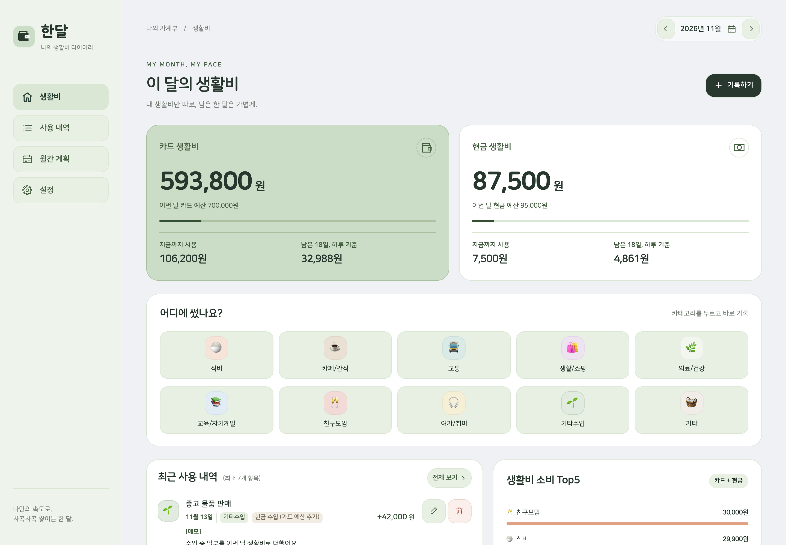
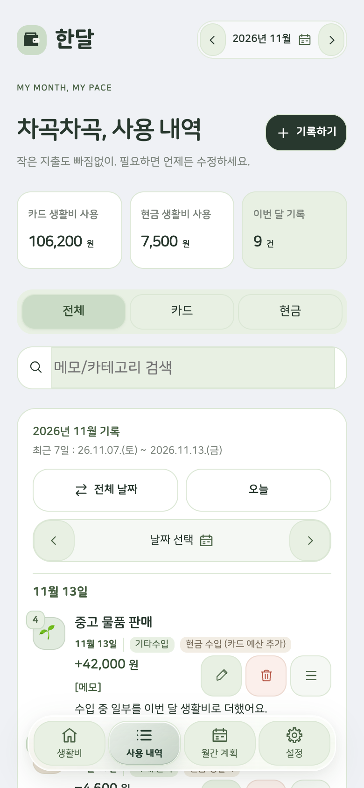
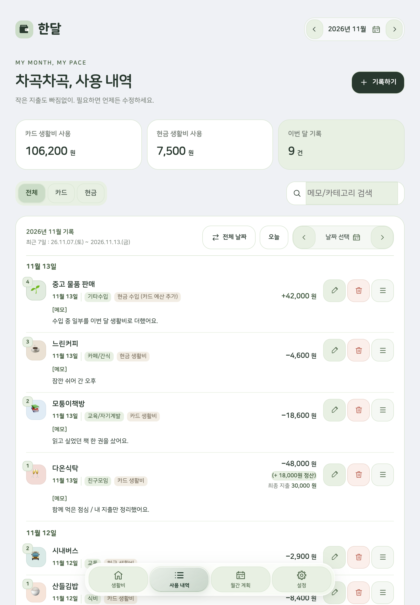
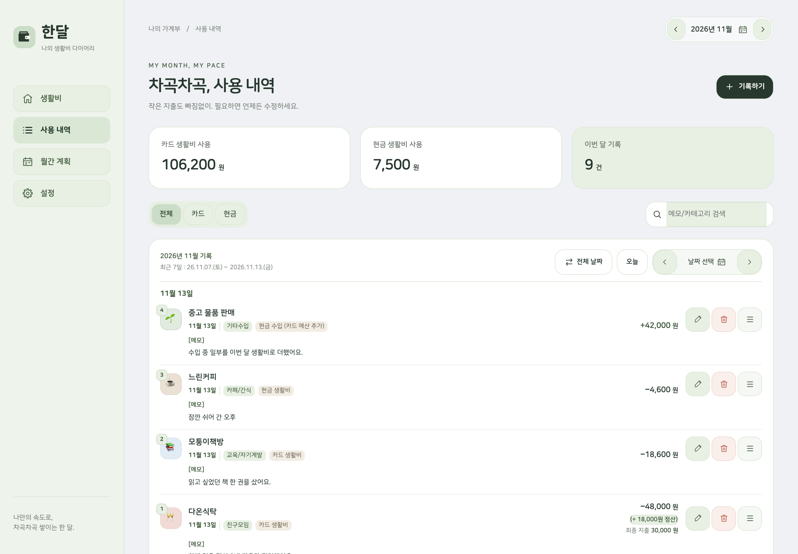
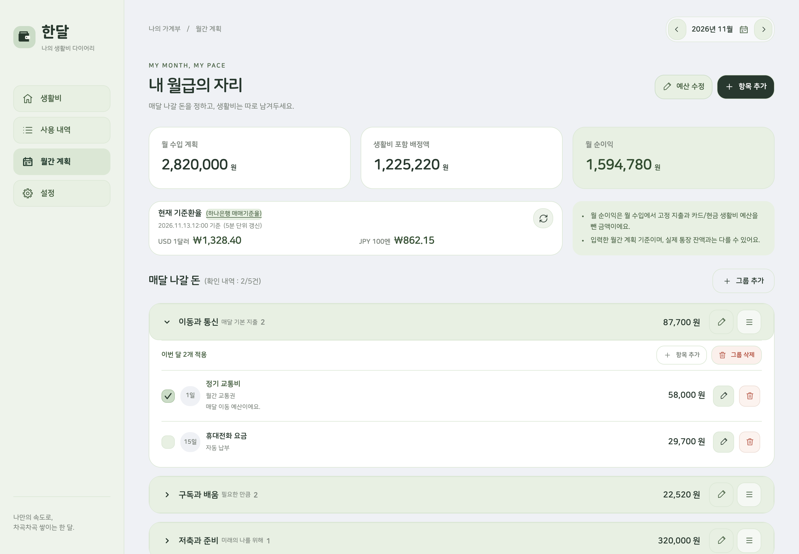

# 한달 화면과 기능 소개

[소개 페이지](https://hyeondk.github.io/handal/) / [화면 둘러보기](README.md#화면으로-둘러보기)

한달은 생활비 예산과 사용 내역, 매달 나갈 돈을 한곳에서 정리하는 개인 가계부 프로젝트예요. 이 문서는 화면 구성과 기능을 소개하며, 앱 접속이나 설치 절차는 제공하지 않습니다. 아래 화면과 금액은 모두 가상 예시입니다.

## 생활비

카드 생활비와 현금 생활비를 나누어 남은 금액 / 지금까지 사용한 금액 / 하루 기준 금액을 보여줘요. 최근 사용 내역은 최대 7개까지 표시하고, 선택한 달의 생활비 소비 상위 5개 카테고리를 함께 살펴볼 수 있어요.

## 사용 내역

선택한 월의 최근 7일 / 전체 날짜 / 오늘 / 특정 날짜로 기록을 살펴볼 수 있어요. 제목은 가게명으로 표시하고 자세한 메모는 `[메모]` 영역에 따로 보여줘요. 메모에는 굵게 / 기울임 / 목록 / 번호 목록 / 코드 서식을 사용할 수 있어요.

환불 / 정산은 원래 지출과 연결해 정산 금액과 최종 지출을 함께 보여줘요. 가상 화면의 ‘다온식탁’은 원래 48,000원을 지출하고 18,000원을 정산받아 최종 지출이 30,000원인 예시예요.

### 스마트폰

### 태블릿

### PC

## 월간 계획

정기 지출을 그룹별로 정리하고 금액 / 결제일 / 납부 여부를 관리해요. 날짜가 있는 항목은 일자순으로, 같은 날짜의 항목은 이름순으로 표시해요. 날짜가 없는 ‘매월’ 항목은 아래에 이름순으로 배치해요.

카드와 현금 생활비 예산을 함께 계획하고, 다음 달 예산도 예약할 수 있어요. 외화 항목은 결제일 기준 환율과 원화 환산 금액을 함께 보여줘요. ‘월 순이익’은 입력한 계획에 따른 계산이며 실제 통장 잔액과 다를 수 있어요.

## 설정

생활비 예산 / 카테고리 / 저장 상태를 접이식 카드로 정리해요. 카테고리 이름과 아이콘, 순서를 내 방식대로 구성하고 기록을 백업해 보관할 수 있어요.

## 예시 화면에 대하여

모든 이미지는 실제 한달 앱 소스를 사용하되 운영 서버로 나가는 요청을 차단한 가상 환경에서 제작했어요. 합성 계정에서 새로 구성한 자료를 스마트폰 / 태블릿 / PC 화면으로 촬영했습니다.

스마트폰은 390×844 / 태블릿은 820×1180 / PC는 1440×1000 화면 크기로 확인했어요. 실제 사용자의 기록과 로그인 정보는 이미지에 넣지 않았습니다. 환율과 날짜도 설명을 위한 가상 예시입니다.

실행용 비공개 앱 소스와 가상 환경의 실행 스크립트는 이 저장소에 포함하지 않습니다. 공개하는 결과물은 소개 페이지와 설명 문서, 예시 이미지입니다.

기획 / 제작 김동현(hyeondk) / mazy454@hanmail.net
